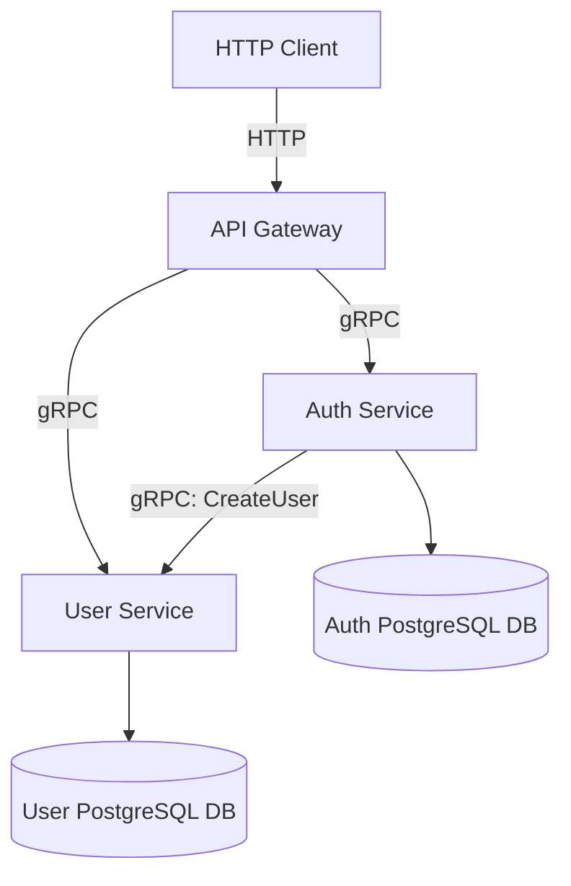

# Go gRPC Microservices

A backend microservices project built with **Go, gRPC, PostgreSQL, and an API Gateway**. The project demonstrates service boundaries, inter-service communication, independent database ownership, and authentication workflows.

## Architecture Overview

The application consists of three independently running services:

| Service | Responsibility | Communication |
|---|---|---|
| API Gateway | Entry point for client requests; routes requests to backend services | HTTP |
| Auth Service | Signup, signin, credential management, access tokens, and refresh tokens | gRPC |
| User Service | User profile creation and profile management | gRPC |

### High-Level Architecture



## Service Responsibilities

### 1. API Gateway

- Exposes HTTP endpoints to clients.
- Communicates with Auth Service and User Service through gRPC clients.
- Converts incoming HTTP requests into backend service requests.
- Converts gRPC responses into HTTP responses.

### 2. Auth Service

- Handles user registration and authentication.
- Hashes and verifies passwords.
- Manages authentication credentials.
- Generates access tokens.
- Manages refresh-token operations.
- Calls User Service during signup to create the user's profile.

### 3. User Service

- Owns user profile information.
- Creates and manages user profiles.
- Exposes profile-related operations through gRPC.
- Maintains its own PostgreSQL database.

## Database Ownership

Each service owns its database.

| Database | Owner | Data |
|---|---|---|
| Auth DB | Auth Service | Credentials, password hashes, roles, refresh-token state |
| User DB | User Service | User profiles, names, emails, timestamps |

Both databases use the same logical user UUID to associate a user's profile with their authentication credentials.

There is no direct cross-service database access or cross-database foreign key.

## Signup Workflow

1. Client sends an HTTP signup request to API Gateway.
2. Gateway forwards the request to Auth Service using gRPC.
3. Auth Service calls User Service using gRPC to create a user profile.
4. User Service stores the profile in its own database and returns the user ID.
5. Auth Service hashes the password and stores the credentials in its own database.
6. Auth Service generates the authentication tokens and returns the signup response.

**Important:** The profile and credential writes happen in separate databases. They are not covered by one distributed transaction. A failure between these operations can leave an incomplete registration.

## Technology Stack

- **Language:** Go
- **RPC Framework:** gRPC
- **API Protocol:** HTTP
- **Database:** PostgreSQL
- **Database Access:** `database/sql`
- **Authentication:** JWT
- **Containerization:** Docker (where configured)

## Project Structure

The repository is organized around independently running services and shared protobuf definitions.

```text
go-grpc-microservices/
├── api-gateway/
├── auth-service/
├── user-service/
├── proto/
└── README.md
```

The exact internal package structure is maintained within each service.

## Running Locally

Before running the services:

1. Install the required Go toolchain.
2. Start PostgreSQL databases for Auth Service and User Service.
3. Configure environment variables for each service.
4. Run the database migrations.
5. Start User Service.
6. Start Auth Service.
7. Start API Gateway.

See the service-specific configuration and startup instructions for exact commands and environment variables.

## Engineering Considerations

The project focuses on understanding and implementing:

- Microservice boundaries and responsibility ownership.
- Database-per-service architecture.
- Synchronous inter-service communication using gRPC.
- Authentication and token lifecycle management.
- Distributed failure handling.
- Database consistency across independent services.
- Testing and operational reliability.

## Project Status

This is an evolving backend engineering project. Features and production-hardening measures are implemented incrementally. The presence of a technology or architectural pattern in this document does not imply that every production safeguard has already been implemented.