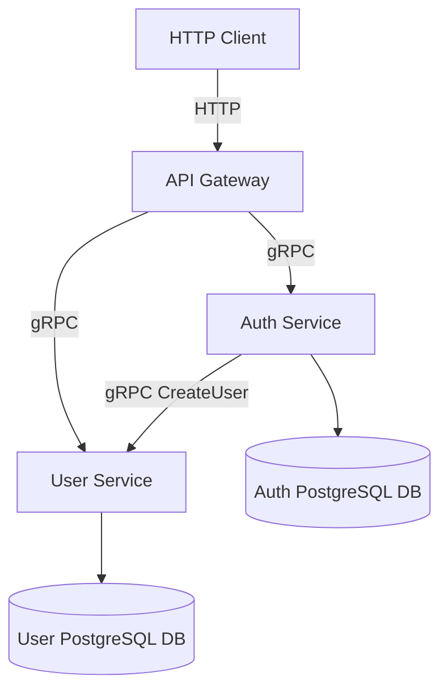

# System Architecture

## 1. Overview

The application follows a microservices architecture consisting of three independently running components:

1. **API Gateway** – Acts as the entry point for external client requests.
2. **Auth Service** – Owns authentication, credentials, and token management.
3. **User Service** – Owns user profile information and profile-related operations.

Each backend service is responsible for its own business logic and database.

## 2. High-Level Architecture

## 3. Component Responsibilities

### API Gateway

The API Gateway provides a single HTTP entry point for clients.

Responsibilities:

- Exposes HTTP endpoints.
- Routes authentication requests to Auth Service.
- Routes profile-related requests to User Service.
- Communicates with backend services using gRPC clients.
- Converts HTTP requests into gRPC requests.
- Converts gRPC responses into HTTP responses.

The Gateway does not directly access backend service databases.

### Auth Service

Auth Service owns authentication-related business logic and data.

Responsibilities:

- Handles user signup and signin.
- Hashes and verifies passwords.
- Stores authentication credentials.
- Generates and validates access tokens.
- Manages refresh-token creation, rotation, and revocation.
- Coordinates profile creation by calling User Service during signup.

Auth Service communicates with User Service through its gRPC API rather than accessing its database directly.

### User Service

User Service owns user profile information.

Responsibilities:

- Creates user profiles.
- Retrieves user profile information.
- Handles profile-related operations.
- Maintains its own PostgreSQL database.
- Exposes profile operations through gRPC.

User Service does not manage passwords, authentication credentials, or refresh tokens.

## 4. Inter-Service Communication

The services communicate using synchronous gRPC calls.

| Source | Destination | Protocol | Purpose |
|---|---|---|---|
| Client | API Gateway | HTTP | External API requests |
| API Gateway | Auth Service | gRPC | Authentication operations |
| API Gateway | User Service | gRPC | Profile operations |
| Auth Service | User Service | gRPC | Create profile during signup |

### Why gRPC?

gRPC provides:

- Strongly typed service contracts through Protocol Buffers.
- Efficient service-to-service communication.
- Generated client and server interfaces.
- Support for deadlines, cancellation, and status codes.

## 5. Database-per-Service Pattern

Each service owns and manages its database independently.

| Service | Database | Responsibility |
|---|---|---|
| Auth Service | Auth PostgreSQL DB | Credentials and authentication state |
| User Service | User PostgreSQL DB | User profile information |

### Auth Database

Stores authentication-related information, such as:

- User ID
- Email
- Password hash
- Role
- Refresh-token records

### User Database

Stores profile-related information, such as:

- User ID
- Name
- Email
- Created timestamp
- Updated timestamp

### Shared User Identity

The same UUID identifies a user across both databases.

For example:

- `user_db.users.id`
- `auth_db.credentials.id`

This UUID is a logical relationship between service-owned records. It is not a foreign key between the databases.

## 6. Signup Orchestration

Signup involves both Auth Service and User Service.

The Auth Service coordinates the workflow:

1. Receives the signup request.
2. Calls User Service through gRPC to create a profile.
3. Receives the generated user ID.
4. Hashes the password.
5. Stores authentication credentials in Auth DB.
6. Generates and returns authentication tokens.

This is synchronous service orchestration.

### Important Consistency Consideration

The two database writes are independent transactions.

For example:

1. User Service successfully creates a profile.
2. Auth Service fails to store credentials.

In this situation, the profile exists without corresponding authentication credentials.

An Auth Service database transaction cannot roll back a committed transaction in User Service.

This requires an explicit distributed failure-handling strategy, such as compensation, a pending-registration workflow, or reconciliation.

## 7. Architectural Principles

The project follows these principles:

- **Single Responsibility:** Each service owns a specific business capability.
- **Database Ownership:** Services access only their own databases directly.
- **Loose Coupling:** Services communicate through defined gRPC contracts.
- **Independent Deployment:** Services can run as separate processes.
- **Explicit Communication:** Inter-service dependencies are visible through service calls.
- **Failure Awareness:** A failure in one service can affect workflows that depend on it.

## 8. Current Limitations and Future Improvements

The architecture provides service separation, but additional work is required before considering it production-ready.

Areas to strengthen:

- Distributed consistency during signup.
- Idempotent registration and safe retries.
- gRPC deadlines and timeout handling.
- Authentication and authorization enforcement at service boundaries.
- Secure service-to-service communication using TLS.
- Graceful shutdown and health checks.
- Structured logging, metrics, and distributed tracing.
- Integration and failure-scenario testing.

These are implementation and operational improvements, not reasons to change the current service boundaries.