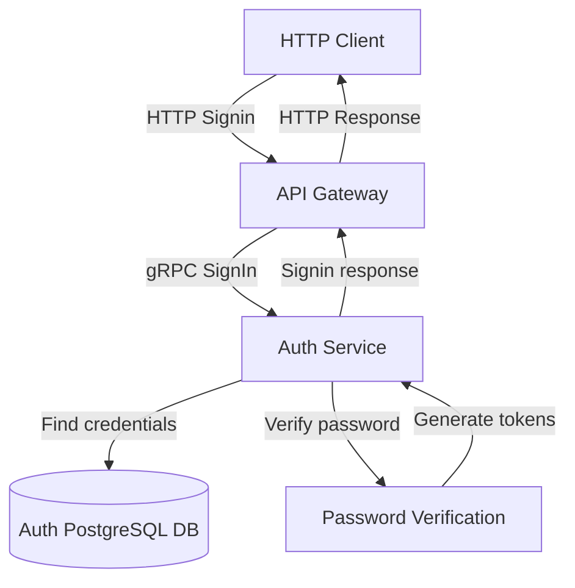
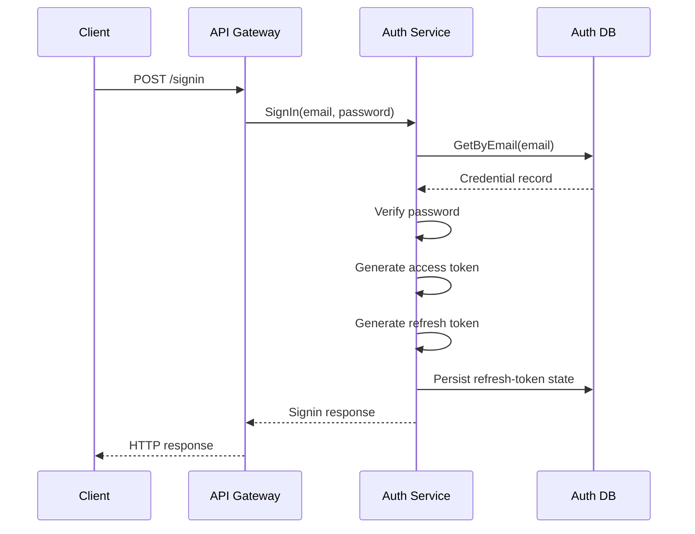
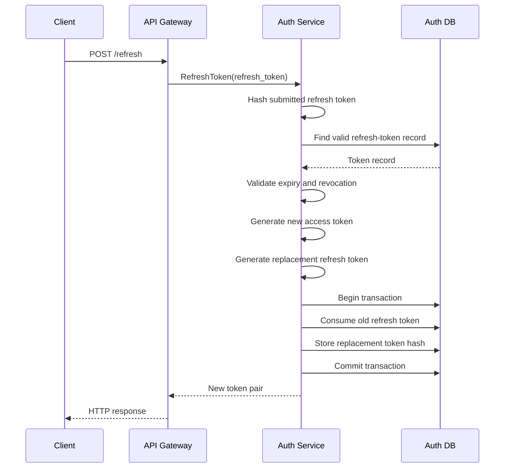
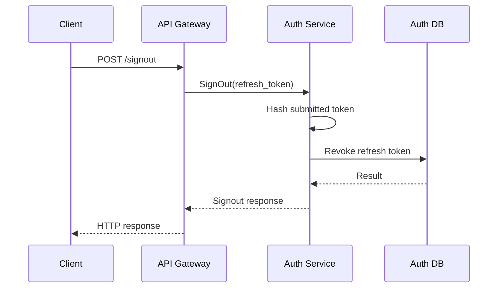
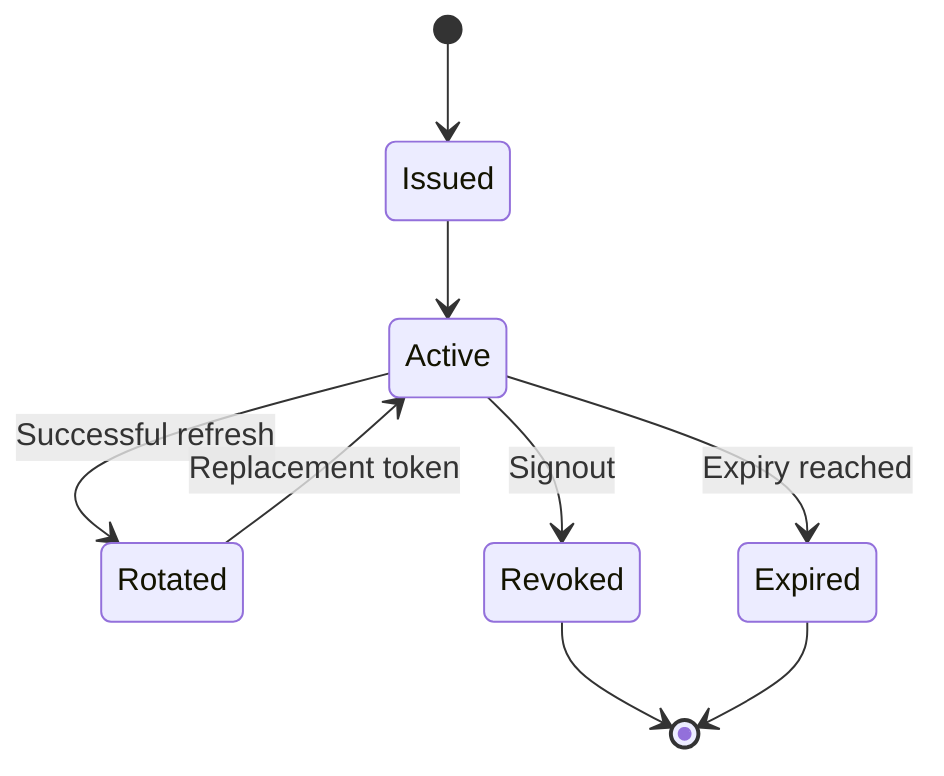

# Authentication Flows

## 1. Overview

Auth Service owns authentication and token lifecycle management.

It handles:

- User signin.
- Password verification.
- Access-token generation.
- Refresh-token generation and rotation.
- Refresh-token revocation during signout.

Unlike signup, these operations do not normally require a call to User Service because Auth Service already owns the credentials required for authentication.

## 2. Signin Flow

### Purpose

Signin verifies the user's credentials and issues authentication tokens.

### Architecture



### Sequence Diagram



### Steps

1. Client submits email and password.
2. API Gateway forwards the request to Auth Service using gRPC.
3. Auth Service retrieves the credential record using the email.
4. Auth Service verifies the submitted password against the stored password hash.
5. If verification succeeds, Auth Service generates an access token.
6. Auth Service generates a refresh token.
7. Auth Service persists the refresh-token state.
8. Auth Service returns the tokens through API Gateway.

### Important Considerations

- Passwords must never be stored in plaintext.
- Invalid credentials should produce a consistent authentication error.
- Password hashes must not be exposed in API responses.
- Tokens must not be logged.
- Refresh-token persistence must succeed before returning a successful signin response.

## 3. Refresh Token Flow

### Purpose

Access tokens have a limited lifetime. Refresh tokens allow users to obtain new access tokens without submitting their passwords again.

Auth Service owns refresh-token validation, rotation, and revocation.

### Sequence Diagram



### Steps

1. Client submits its refresh token.
2. Gateway forwards the request to Auth Service.
3. Auth Service hashes the submitted token.
4. Auth Service checks whether the corresponding token exists and is valid.
5. Auth Service verifies expiry and revocation status.
6. Auth Service generates a new access token and refresh token.
7. Auth Service consumes the old refresh token and stores the replacement token within a database transaction.
8. Auth Service returns the new tokens.

### Refresh Token Rotation

A refresh token should not be reusable indefinitely.

After successful refresh:

- The old refresh token becomes invalid.
- A replacement refresh token is issued.
- The replacement token's hash is persisted.
- Reuse of the old token must be rejected.

### Atomicity Consideration

Token validation and consumption must be designed to prevent concurrent requests from successfully using the same refresh token.

A conditional database update inside a transaction is one possible approach:

```sql
UPDATE refresh_tokens
SET revoked = TRUE
WHERE token_hash = $1
  AND revoked = FALSE
  AND expires_at > NOW()
RETURNING user_id;
```

If no row is returned, the token is invalid, expired, or already consumed.

The replacement token should be inserted in the same transaction.

## 4. Signout Flow

### Purpose

Signout invalidates the user's refresh token so it cannot be used to obtain new access tokens.

### Sequence Diagram



### Steps

1. Client submits the refresh token to the signout endpoint.
2. Gateway forwards the request to Auth Service.
3. Auth Service hashes the submitted token.
4. Auth Service finds and revokes the corresponding refresh-token record.
5. Auth Service returns the signout result.

### Important Considerations

- A revoked refresh token must not be accepted again.
- Signout should be safe to retry according to the API's defined semantics.
- Access tokens already issued may remain valid until expiry unless an additional revocation mechanism is implemented.
- Token hashes, not raw tokens, should be used for database lookups.

## 5. Token Lifecycle



## 6. Security Responsibilities

Auth Service should ensure:

1. Passwords are securely hashed.
2. JWT signing secrets or keys are securely configured.
3. JWT verification restricts accepted signing algorithms.
4. Access tokens have an appropriate expiry.
5. Refresh tokens are generated using cryptographically secure randomness.
6. Refresh tokens are stored as hashes.
7. Refresh-token rotation is atomic.
8. Revoked and expired refresh tokens cannot be reused.
9. Sensitive authentication data is never logged.

## 7. Future Improvements

- Concurrent refresh-token rotation testing.
- Refresh-token reuse detection.
- Session management across multiple devices.
- Access-token revocation strategy.
- Rate limiting for signin attempts.
- Authentication and authorization integration tests.
- Secure key rotation.
