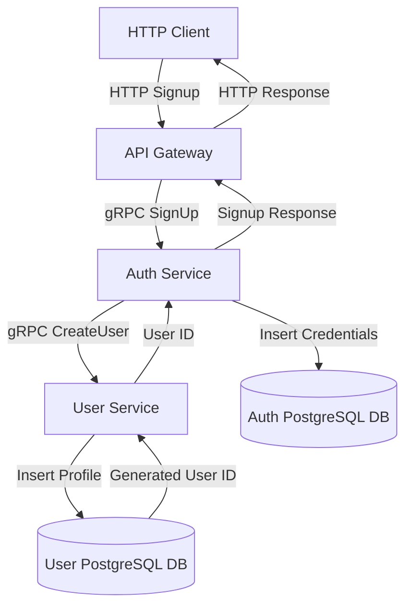
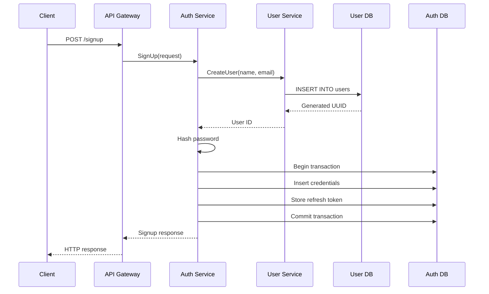

# Signup Flow

## 1. Overview

User registration involves two independently owned services:

- **User Service:** Creates and stores the user's profile.
- **Auth Service:** Stores authentication credentials and manages token generation.

Auth Service coordinates the signup workflow by communicating with User Service through gRPC.

Each service writes to its own PostgreSQL database.

## 2. Signup Architecture



## 3. Signup Sequence

The following sequence describes the current logical workflow.



The exact order of password hashing, access-token generation, refresh-token persistence, and transaction operations should match the current `AuthService.SignUp()` implementation.

## 4. Step-by-Step Responsibilities

### Step 1: Client Sends Signup Request

The client sends registration details to the API Gateway.

Example request:

```json
{
  "name": "John",
  "email": "john@example.com",
  "password": "example-password"
}
```

The Gateway forwards the request to Auth Service using the generated gRPC client.

### Step 2: Auth Service Calls User Service

Auth Service invokes the User Service's `CreateUser` RPC.

It sends profile information such as:

- Name
- Email

User Service is responsible for validating and creating the profile.

### Step 3: User Service Creates the Profile

User Service inserts the profile into its own PostgreSQL database.

Example:

```sql
INSERT INTO users (name, email)
VALUES ($1, $2)
RETURNING id;
```

User Service returns the generated UUID to Auth Service.

### Step 4: Auth Service Creates Credentials

After receiving the user ID, Auth Service:

1. Hashes the submitted password.
2. Starts a transaction in Auth DB.
3. Creates the credential record using the returned user ID.
4. Persists the refresh-token state.
5. Commits the transaction.

Example:

```sql
INSERT INTO credentials (id, email, password_hash)
VALUES ($1, $2, $3);
```

The UUID is supplied by User Service rather than independently generated by Auth Service.

### Step 5: Auth Service Returns the Response

After the required database operations succeed, Auth Service returns the signup response through the Gateway.

The Gateway converts the gRPC response into an HTTP response for the client.

## 5. Database Ownership

A successful signup creates related records in two databases.

**User DB**

```text
users
--------------------------------
id          UUID
name        TEXT
email       TEXT
created_at  TIMESTAMPTZ
updated_at  TIMESTAMPTZ
```

**Auth DB**

```text
credentials
--------------------------------
id             UUID
email          TEXT
password_hash  TEXT
role           user_role
created_at     TIMESTAMPTZ
```

The `id` value represents the same logical user in both databases.

These are independently owned records. There is no cross-database foreign key.

The actual schema should be verified against the service migrations.

## 6. Transaction Boundaries

Auth Service can use a SQL transaction for its own database operations.

User Service performs its profile insertion independently.

Therefore:

- User DB transaction is owned by User Service.
- Auth DB transaction is owned by Auth Service.
- The entire signup workflow is not one atomic transaction.

A successful Auth DB transaction cannot roll back an already committed User DB transaction.

## 7. Distributed Failure Scenario

Consider the following situation:

1. Auth Service calls User Service.
2. User Service successfully creates the profile.
3. User Service commits its database transaction.
4. Auth Service attempts to insert credentials.
5. Auth DB returns an error.

Result:

```text
User DB
-------
Profile: EXISTS

Auth DB
-------
Credentials: NOT CREATED
```

The user profile exists, but the user cannot authenticate because the credentials were not persisted.

This is a partial failure in a distributed workflow.

## 8. Possible Consistency Strategies

Several approaches can address this problem.

### Compensation

Auth Service can request a compensating operation, such as deleting the newly created profile, when credential creation fails.

Compensation is a new operation, not a rollback of the User Service transaction. It can also fail and must be handled.

### Pending Registration

Registration can be represented as a pending workflow.

The registration becomes active only after the required profile and credential operations complete.

Expired or incomplete registrations can be reconciled.

### Saga Pattern

A saga coordinates multiple local transactions and defines recovery or compensating actions when a step fails.

It can be implemented with orchestration or choreography depending on the workflow.

### Reconciliation

A background process can identify incomplete registrations and repair or clean them up according to defined business rules.

These are possible improvements, not claims that the current implementation already supports them.

## 9. Idempotency Considerations

Signup requests may be repeated because of:

- Client retries.
- Gateway timeouts.
- Network interruptions.
- Uncertain outcomes after a database commit.

The registration workflow should prevent duplicate profile and credential records.

A stable registration identifier or idempotency key can help the services safely recognize repeated requests.

Retries should be bounded and should not blindly repeat non-idempotent operations.

## 10. Signup Invariants

The following conditions should hold:

1. A successful registration has one profile record and one credential record.
2. Both records use the same user UUID.
3. Passwords are never stored in plaintext.
4. Auth Service never directly accesses User DB.
5. User Service never directly accesses Auth DB.
6. Tokens are returned only after the required persistence operations succeed.
7. Repeated signup requests must not create duplicate registrations.
8. Partial failures must be detectable and recoverable.