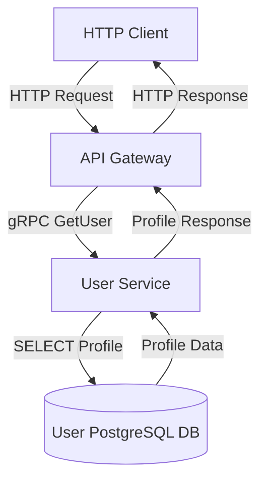
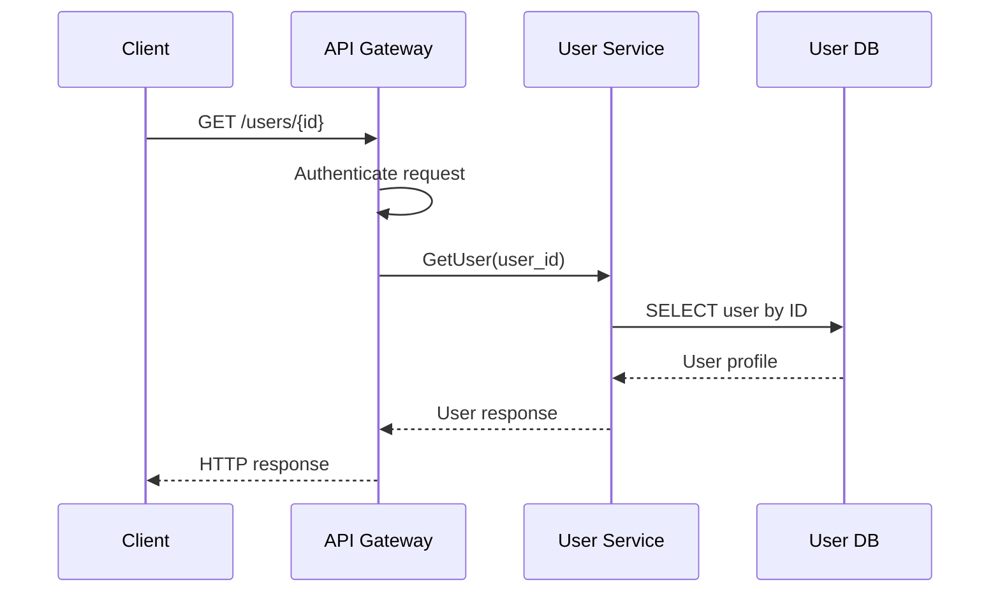
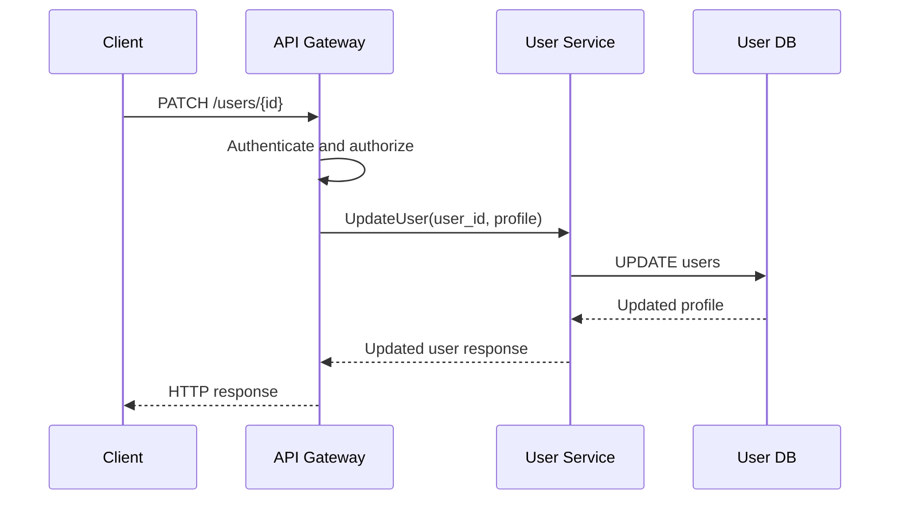
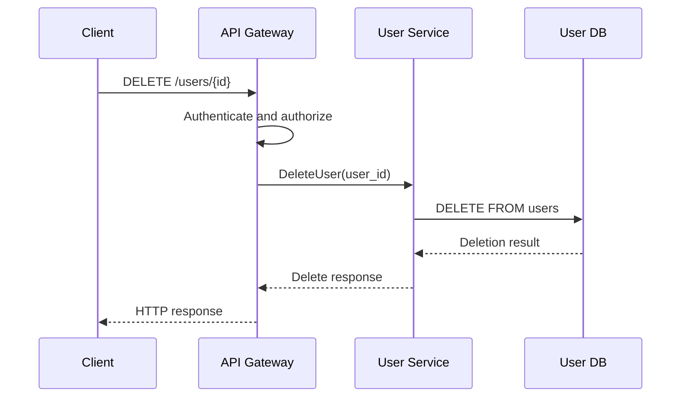

# User Profile Flows

## 1. Overview

User Service owns user profile information and exposes profile-related operations through gRPC.

The API Gateway acts as the HTTP entry point and forwards profile requests to User Service.

Auth Service is responsible for authentication credentials and token management. It does not directly manage user profile records.

## 2. Profile Retrieval

### Purpose

Allows an authenticated user to retrieve their profile information.

### Architecture

### Sequence Diagram

### Steps

1. Client sends a profile retrieval request.
2. API Gateway authenticates the request according to the configured authentication mechanism.
3. Gateway forwards the request to User Service through gRPC.
4. User Service retrieves the profile from its own database.
5. User Service returns the profile response.
6. Gateway converts the response into HTTP.

### Important Considerations

- The requested user ID must be validated.
- User Service should return a not-found result when the profile does not exist.
- Access to a profile must be authorized according to the application's ownership or administrative rules.
- Internal database errors should not be exposed to clients.

## 3. Profile Update

### Purpose

Allows a user to update profile information such as their name or email, depending on the supported API.

### Sequence Diagram

### Steps

1. Client submits the profile update request.
2. API Gateway authenticates and authorizes the request.
3. Gateway forwards the update request to User Service.
4. User Service validates the requested changes.
5. User Service updates the profile in User DB.
6. User Service returns the updated profile.
7. Gateway returns the HTTP response.

### Important Considerations

- Validate all fields before updating.
- Prevent unauthorized users from modifying another user's profile.
- Handle duplicate email conflicts if email updates are supported.
- Update `updated_at` when profile information changes.
- Use parameterized SQL queries.
- Define whether partial updates or complete replacements are supported.

### Email Update Consideration

Email exists in both User DB and Auth DB in the current design.

If email updates are supported, changing the profile email in User Service alone can leave Auth DB with an outdated email.

A coordinated workflow is needed to keep both records consistent. Do not assume that updating one database automatically updates the other.

## 4. Profile Deletion

### Purpose

Allows an authorized user or administrator to delete a user profile.

### Sequence Diagram

### Steps

1. Client submits a profile deletion request.
2. API Gateway authenticates and authorizes the request.
3. Gateway forwards the request to User Service.
4. User Service validates the operation.
5. User Service deletes the profile from its database.
6. User Service returns the result.
7. Gateway returns the HTTP response.

### Important Considerations

- Only authorized users should be able to delete profiles.
- Define whether deletion is permanent or implemented as soft deletion.
- Handle deletion of profiles that do not exist.
- Consider audit and retention requirements.
- Define how associated authentication credentials and refresh tokens are handled.

### Cross-Service Deletion Consistency

Deleting a profile from User DB does not automatically delete its credentials or revoke refresh tokens in Auth DB.

This requires a deliberate cross-service lifecycle strategy.

Possible approaches include:

- Auth Service first disables the account and revokes active refresh tokens, then User Service deletes the profile.
- A coordinated saga handles deletion across both services.
- An event-driven workflow propagates account deletion and supports retries and reconciliation.

The chosen strategy must account for partial failures so that deleted profiles cannot continue authenticating.

## 5. Service Responsibilities

| Operation | Responsible service | Database |
|---|---|---|
| Get profile | User Service | User DB |
| Update profile | User Service | User DB |
| Delete profile | User Service | User DB |
| Verify password | Auth Service | Auth DB |
| Revoke refresh token | Auth Service | Auth DB |

## 6. Authorization Considerations

Authentication confirms who the caller is. Authorization determines what that caller is allowed to do.

For profile operations:

- A user should normally access and modify their own profile.
- Administrative access should be explicitly authorized.
- User Service should enforce the authorization rules required at its boundary rather than blindly trusting client-supplied user IDs.
- The mechanism for propagating trusted identity from Gateway to User Service must be explicitly implemented and secured.

## 7. Future Improvements

- Profile ownership authorization tests.
- Duplicate-email update tests.
- Concurrent profile update handling.
- Soft deletion and account lifecycle policy.
- Coordinated credential and profile deletion.
- Email-change consistency workflow.
- Integration tests for profile CRUD operations.
